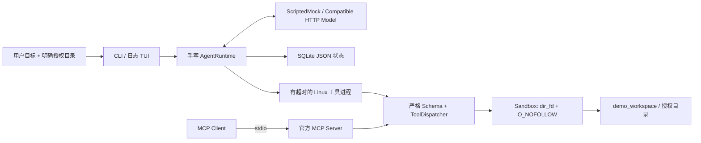

# Workspace Task Agent

**一个会查资料、调用工具、在授权目录内预览或写出结果的 Python Agent。** 从零编写 Function Calling Loop，把计划、权限、状态、失败恢复和可核验的文件产物串起来。默认 CPU + 离线 Mock，无 Key、无模型下载、无付费服务前置。

> **English overview:** A sandboxed workspace task agent with a handwritten function-calling loop, durable SQLite state, strict tools, explicit write approval, and a real MCP stdio server/client. The deterministic offline demo reads original RAG notes and produces an evidence-grounded study plan. An OpenAI-compatible adapter supports configured live models.

实际解决的问题：自然语言模型可以“说已经整理了文件”，但应用需要证明它读了哪些材料、为何停下、是否真的写入，以及崩溃后能否安全判断结果。本项目把模型建议与实际执行分开记录，用真实文件与 SHA-256 证据核验写入。

## 可以展示的能力

- **手写 Agent Loop**：消息 → 模型工具建议 → 严格参数校验 → 沙盒派发 → observation → 下一轮；支持单轮多工具调用。
- **明确规划与恢复**：固定四步可读计划，根据缺失文件、参数错误和预览结果记录调整；限制迭代、调用数、时间、token 预算与重复调用。
- **六个真实工具**：列目录、读文件、字面量搜索、写文件、安全算术、持久 todo；无 shell、任意网络、动态求值或删除工具。
- **可审计权限**：写入默认预览；显式批准仍受沙盒约束；覆盖需要操作者和工具参数双方授权。
- **可恢复状态**：SQLite JSON 快照保存运行 ID、计划、已完成项、调用意图、实际结果和错误；恢复不自动重放副作用。
- **真正的 MCP**：官方 Python SDK v2，独立 stdio Server/Client；四个文件工具与原生派发共享 Schema、权限和错误。
- **真实记录 TUI**：计划进度、工具 timeline、错误与已核验 artifact；不展示模型私有推理。



## Quick Start：免费离线闭环

支持 **Linux / WSL、Python 3.10+**。在本仓库根目录执行；推荐使用已安装的 `uv`，安装过程只创建项目 `.venv`。首次安装依赖需要访问公开包索引；完成后 Mock 与 stdio 演示可离线运行。

```bash
make install
.venv/bin/agent init-demo
.venv/bin/agent run '查找 RAG 笔记，整理差异并生成 study_plan.md' --workspace demo_workspace --dry-run
.venv/bin/agent run '查找 RAG 笔记，整理差异并生成 study_plan.md' --workspace demo_workspace --approve-writes
cat demo_workspace/study_plan.md
.venv/bin/agent tui
```

默认不写文件，`--dry-run` 让演示意图更清楚；它与 `--approve-writes` 互斥。重复写已有产物会被拒绝，需要额外使用 `--allow-overwrite`，Mock 才会相应提出 `overwrite=true`。

一键演示每次创建全新的专用临时目录，不删除任何已有文件，连续演示预览、批准写入、文件核验、MCP 对比和 TUI：

```bash
make demo
```

已实测的调用顺序为：`list_files` / `calculator` → 读取不存在文件并收到 `FILE_NOT_FOUND` → `search_files` → 读取实际命中的三篇原创笔记 → `write_file` → 最终结果。产物包含确定性提取的职责/差异原文、实际材料引文、学习步骤和相对来源路径。控制台会输出实际 run ID 与 artifact 位置；哈希以当次真实证据为准。

Mock 是固定的 RAG 笔记工作流，**不理解任意自然语言任务**。真实任务选择由下面的模型适配器完成；本项目不把脚本演示当成真实模型评测。

## 真实 LLM：OpenAI-compatible Function Calling

默认不读取 `.env`。需要时复制 `.env.example` 到本机 `.env`，通过 shell 显式导出自己的配置；不要提交私人配置。API base 应包含服务要求的版本前缀，程序在其后追加 `/chat/completions`。

```bash
cp .env.example .env
# 在本机编辑 .env，填入 WA_API_BASE_URL、WA_MODEL；需要认证时填写 WA_API_KEY。
set -a
source .env
set +a
.venv/bin/agent run '比较授权目录里的笔记，写一份带来源的摘要' --model api --workspace demo_workspace --dry-run
```

支持非流式 Chat Completions `tools` / `tool_calls` 协议，按调用 ID 追加 `role=tool` observation；校验模型响应和工具参数，限制 HTTP 响应大小、超时与 completion 长度。服务需支持标准 function calling；未实现 Responses、流式、图片或供应商专有参数。模型接口配置只由操作者提供，Agent 工具不能选择网络目标。接口模式会把获准读取的正文发送给配置的服务。

请求前预留 UTF-8 字节估算与输出 allowance；有 provider usage 时记录报告值，缺失或超时则记录估算值。`token_charges` 记录来源。这是本地预算控制，**不是跨服务精确 tokenizer 或费用封顶保证**。实际远程模型未配置、未实测；HTTP adapter 通过 Fixture 验证。

## 命令与真实状态

```bash
.venv/bin/agent runs
.venv/bin/agent inspect <run_id>
.venv/bin/agent tui <run_id> --watch
.venv/bin/agent recover <run_id>
.venv/bin/agent run '读取材料' --workspace demo_workspace --max-iterations 8 --max-tool-calls 20 --max-tokens 24000 --timeout 60
.venv/bin/agent mcp-demo --workspace demo_workspace
.venv/bin/python -m workspace_agent.mcp_server --workspace demo_workspace
```

`recover` 将遗留 `running` 状态标记为 `interrupted`，展示尚未保存结果的调用，不会自动续跑。`inspect` 会显示原始本地消息与工具数据，应按个人运行数据保护。`.agent/` 不提交 Git。

MCP Demo 启动独立进程，发现四工具，逐一比较列目录、读文件、搜索、写预览、越权路径、非法类型共六组结果，真实运行结果均匹配。Server stdout 只承载协议。原生/MCP 的参数与错误路径对照见 [DEMO](docs/DEMO.md)。

## 验证与工程入口

```bash
make lint
make test
make demo
make mcp-demo
make docker
.venv/bin/python scripts/privacy_check.py --history --include-untracked
```

本地实际执行：**202 项 pytest 通过，Ruff check 与 format 检查通过**；Docker 无网络 Mock 写入及容器内 MCP 六组对比均通过。GitHub 托管 CI 的 Python 3.10、3.12 与 Docker 三个 jobs 也已真实通过，详见 [VALIDATION.md](docs/VALIDATION.md)。测试在独立临时目录覆盖沙盒、覆盖保护、注入、参数修复、预算、循环、超时、中断、持久化与真实 MCP 子进程。

`uv.lock` 锁定开发环境；`requirements.lock` 是带哈希的生产依赖导出，Docker 使用该文件安装。无 `uv` 时 `scripts/install.sh` 使用系统 Python venv + pip，依赖按 pyproject 范围解析；系统需已具备 venv 支持。未进行系统级安装。

Docker 默认以非 root 用户运行。示例以 `--network none`、移除 capabilities、`no-new-privileges` 运行离线 Mock。镜像内产物随 `--rm` 容器退出而消失；需要保留产物时，使用本地 CLI，或自行准备授权目录挂载与对应文件权限。

## 安全边界与设计取舍

1. 根目录必须已存在且由操作者明确选择；默认原创演示目录。拒绝 home/仓库/系统根、父路径、绝对路径、编码路径、敏感名称、符号链接、硬链接和特殊文件。无任意 shell/network/delete 工具。
2. 使用固定目录描述符、`O_NOFOLLOW`、路径/inode 前后校验，读写和搜索有文件数、尺寸、深度等资源上限。文件指令始终是数据，不能提高权限。应用沙盒不代替 OS 隔离，不能抵御同 UID 恶意原生进程的所有竞态。
3. 写入需要批准，覆盖再加授权；成功返回重新读取验证的证据。强制中断仍可能留下部分文件，SQLite 快照不提供跨文件事务或 exactly-once；不自动重放不确定写入。
4. 轻量固定计划、顺序工具调用与 JSON 状态便于审查；没有通用 planner、自动续跑、并发写事务或远程 MCP 托管。没有接入 LangGraph / OpenAI Agents SDK，未来加入框架仍须保留这些权限和证据检查。

后续可增加结构化 artifact 校验、更强 OS 隔离、经过幂等设计的恢复、模型任务评测集，以及复杂分支的图式编排；这些均未冒充现有能力或已测性能。

## 阅读与求职展示

- [架构与执行时序](docs/ARCHITECTURE.md)
- [逐条可复制演示](docs/DEMO.md)
- [技术决策与环境差异](docs/TECH_DECISIONS.md)
- [10 个面试追问与真实实现答案](docs/INTERVIEW_GUIDE.md)
- [不编造指标的简历描述](docs/RESUME_BULLETS.md)
- [实施阶段](docs/IMPLEMENTATION_PLAN.md) / [验证记录](docs/VALIDATION.md) / [安全说明](SECURITY.md)

示例笔记为本项目原创，随 [MIT License](LICENSE) 发布。无私人笔记、密钥、数据库或模型权重作为演示前置。
