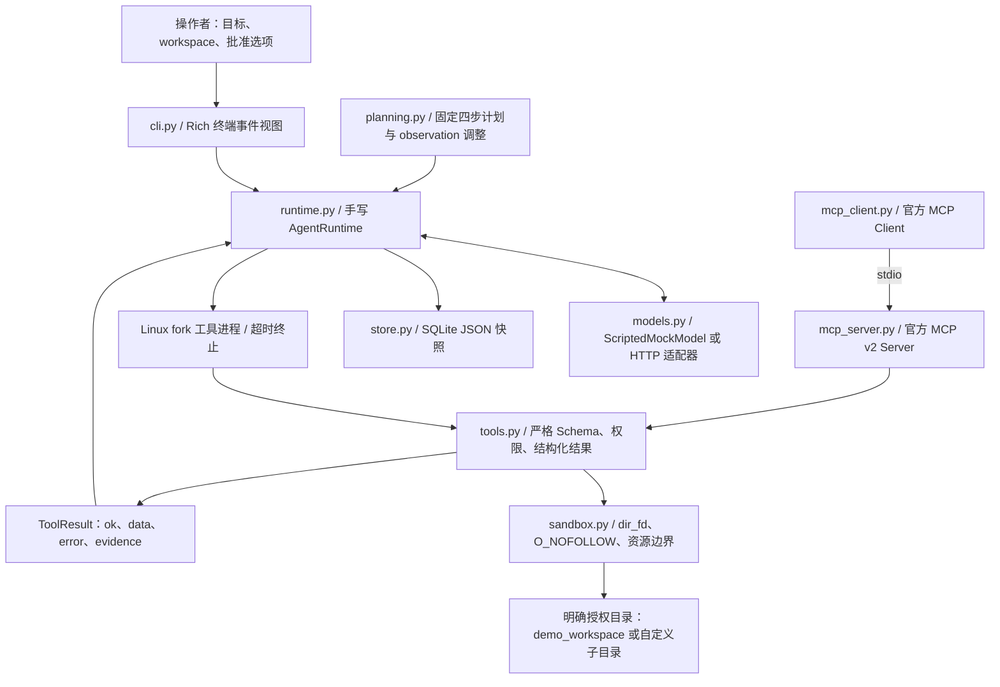
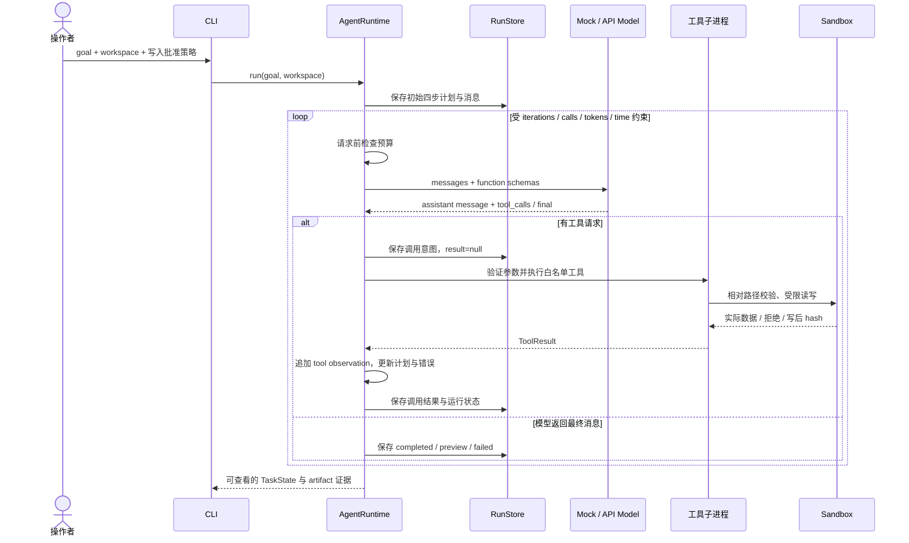

# 架构与实现边界

Workspace Task Agent 把模型产生的工具请求转成受限、可记录、可核验的文件操作。核心循环由项目自行实现，模型适配器只返回消息与 `tool_calls`，文件权限由独立的 Python 工具层决定。

默认 `ScriptedMockModel` 是可重复的 RAG 笔记演示脚本；`--scenario campus` 选择 `CampusDeskMockModel` 整理校园通知。真实自然语言任务通过配置的 OpenAI-compatible API 交给模型；离线脚本不解释任意用户目标，也不模拟通用智能规划。

## 模块与数据流

| 文件 | 实际职责 |
| --- | --- |
| [`domain.py`](../src/workspace_agent/domain.py) | `TaskState`、计划步骤、工具事件与运行预算的 Pydantic 模型 |
| [`planning.py`](../src/workspace_agent/planning.py) | 固定四步计划；根据成功、缺失文件、参数错误和预览结果记录进度与调整 |
| [`runtime.py`](../src/workspace_agent/runtime.py) | 消息循环、工具请求解析、顺序执行、预算、异常边界、检查点 |
| [`models.py`](../src/workspace_agent/models.py) | 确定性离线演示；有大小与超时约束的兼容 HTTP 模型适配器 |
| [`tools.py`](../src/workspace_agent/tools.py) | 六个真实工具、严格入参、结构化结果、写入权限、todo 状态 |
| [`sandbox.py`](../src/workspace_agent/sandbox.py) | 授权根目录、无符号链接路径解析、有限文本读取、写后校验 |
| [`store.py`](../src/workspace_agent/store.py) | SQLite 事务保存 JSON 状态；中断恢复标记，不重放工具 |
| [`cli.py`](../src/workspace_agent/cli.py) | 初始化演示、执行、运行列表、快照查看、恢复、MCP 演示 |
| [`ui.py`](../src/workspace_agent/ui.py) | 只读展示已持久化的计划、工具时间线与写入时已核验产物 |
| [`mcp_server.py`](../src/workspace_agent/mcp_server.py) / [`mcp_client.py`](../src/workspace_agent/mcp_client.py) | 独立 stdio Server/Client；复用原生工具与安全策略 |

## 一次运行的控制顺序

一个模型响应可以提议多个工具调用；当前运行时逐个执行，并在每个副作用之前保存意图。文件内容和工具输出始终作为 `role=tool` 的数据返回，不会被提升为系统消息。终端展示的是真实调用、参数摘要、结果代码与计划调整；项目不展示模型私有推理。

## 计划、错误恢复与停止

初始计划固定为四步：定位材料、读取并引用证据、预览或写出结果、核验并汇总。`observe()` 根据工具结果标记相关步骤完成，并记录“缺失路径先搜索”“校验失败修正参数”“未批准写入仅预览”等调整。这是可观察的工作流骨架；没有实现自动生成任意任务分解的通用 planner。

`FILE_NOT_FOUND` 和 `VALIDATION_ERROR` 会成为下一轮模型可见的 observation，模型可以提出修正请求。离线演示有意读取一次不存在的笔记，然后搜索并读取命中的真实路径。运行时不会自动重试所有工具；相同工具与参数的重复受到循环检测和总调用数限制。

模型超时或可重试的模型错误，在预算仍允许时最多追加一次模型重试。路径、安全、权限和覆盖拒绝会停止当前运行；写工具超时也立即停止，因为磁盘副作用可能已经发生。只读工具超时作为错误交回模型，仍受重复检测、时间与调用数上限约束。

## 状态与恢复语义

`TaskState` 保存用户目标、四步计划、完成项、计划调整、消息、工具历史、错误、最终结果、预算、累计消耗与 run ID。`RunStore` 使用 SQLite 事务保存经 Pydantic 序列化的 JSON，未使用可执行对象反序列化。

调用意图在工具启动前落库：若进程在写入后、结果保存前中断，历史中仍可能出现 `result=null`。`agent recover <run_id>` 把遗留的 `running` 状态改为 `interrupted`，列出不确定调用并保存说明；它不会续跑、重放写操作或假定副作用没有发生。

SQLite 事务保护运行快照，不包含文件写入事务。当前文件写入采用原地写入、`fsync`、重新打开并比较内容与 inode，再返回 SHA-256。强制终止或磁盘故障仍可能留下空文件、部分内容或已写完但尚未记录的文件。恢复后必须核对实际 artifact，再决定发起新 run；没有 exactly-once 保证。

本地 `.agent/` 数据库可能包含用户目标和已读正文，应按运行数据保护；它不属于默认公开材料。工具不能访问点目录中的这份数据库，仓库忽略规则也排除运行数据。

## 预算：控制请求，不冒充账单

| 控制 | 实际机制 |
| --- | --- |
| 迭代与工具调用 | 每轮及每个工具执行前检查上限；多工具批次也逐个计数 |
| 总耗时 | 单调时钟跟踪；模型等待与工具进程分别受剩余时间约束 |
| 工具超时 | Linux/WSL `fork` 保留已固定的沙盒描述符；超时终止并回收工具进程 |
| 请求前预算 | 对消息、工具 Schema 等 JSON 的 UTF-8 字节数作保守估算，并预留模型的单次输出上限 |
| 模型返回 usage | 存在有效正数 usage 时按 provider 报告累加；缺失 usage 时使用估算，不按免费处理 |
| 不确定模型请求 | 非 Mock 请求超时或报错时记录估算消耗，避免失败重试绕开预算 |

`token_charges.source` 区分 `provider`、`request_byte_estimate`、`uncertain_request_byte_estimate` 和 `offline_mock`。字节估算不是指定模型的 tokenizer 计数，也不是供应商账单；provider usage 是返回后的信息。项目通过本地预算抑制失控请求，不承诺跨供应商精确费用封顶。

## 六个工具及证据

六个工具的入参统一使用 `extra="forbid"` 和严格类型验证，返回 `ToolResult(ok, data, error, evidence)`。没有 shell、任意网络、`eval`、`exec` 或删除工具；真实模型 HTTP 请求属于操作者配置的模型适配器。

- `list_files`：有限目录条目，隐藏或敏感名称、符号链接和特殊文件不会被列为可用内容。
- `read_file`：最多 128 KiB 的 UTF-8 文本；拒绝二进制、控制字符、特殊文件与多重硬链接；返回相对路径及实际正文的 SHA-256。
- `search_files`：字面量大小写折叠匹配，限制目录深度、扫描条目、候选文件、正文总量和结果数；无法读取的文件计入跳过统计，隐藏或不可读条目仍消耗扫描额度。
- `write_file`：默认返回 `preview=true, written=false`；批准后才写入。现有文件还同时要求调用中的 `overwrite=true` 与操作者 `--allow-overwrite`，成功结果包含写后重新读取的内容校验。
- `calculator`：AST 白名单递归解释数字与算术运算，限制表达式长度、节点数、深度、指数及数值范围；不运行 Python 动态求值。
- `todo_manager`：列表、新增与完成任务，状态保存在根目录的保留文件 `workspace_todos.json`。新增/完成也受写入批准控制；获准的 todo 动作只授权更新带正确格式标记的自身状态，不授权覆盖普通用户文件。写入前比较旧状态 SHA-256，冲突返回错误；这不等于多写者事务。

写入证据表示工具在返回时核验了实际文件。它不代表模型总结一定正确，不证明文件之后不会被其他进程修改，也不构成内容真实性的密码学证明。目录结果、来源路径与已读正文仍是不可信输入。

## 沙盒威胁模型

根目录必须预先存在，由操作者明确选择。默认演示目录通过 `agent init-demo` 创建；工具不会替模型建立任意根目录。整个 home、仓库根目录、系统目录以及通过符号链接指定的根目录会被拒绝。

路径拒绝绝对路径、父目录穿越、URL 编码、Windows 风格分隔符、点目录、环境变量文件及常见敏感名称。文件操作从固定的根目录描述符出发，逐组件使用 `dir_fd` 与 `O_NOFOLLOW`；读写前后重新核对根目录和祖先目录的位置与 inode，写入后再验证文件内容。测试包含最终路径符号链接交换、祖先目录移动和旧状态被替换的情况。

这是应用层工具约束，不能代替容器权限、独立 OS 用户、Linux 访问控制或其他系统隔离。与 Agent 使用相同 OS 身份的恶意原生进程，仍能在检查与 syscall 之间重命名目录或修改文件。项目通过检查发现多种变化，但不承诺消除这种进程级竞态。不要把自定义根目录指向包含真实秘密的普通工作目录；文件名过滤无法识别所有私人内容，模型 API 模式会将获准读取的内容发送给配置的服务。

## MCP 的复用方式

MCP Server 使用官方 Python SDK v2 的底层 `Server` 与 `on_list_tools` / `on_call_tool` hooks，发布四个文件工具。`input_schema` 直接来自原生 Pydantic 参数模型；收到的原始参数进入同一 `ToolDispatcher`，避免高层函数包装先发生类型转换。返回值同时包含结构化内容、文本 JSON 和一致的 `is_error` 标记。

Client 用固定的当前 Python 解释器和 `-I -m workspace_agent.mcp_server` 启动 stdio 子进程，不接受任意可执行命令。显式环境不传递模型密钥；stdio 的 stdout 只承载协议，启动诊断写到 stderr。连接生命周期和请求受超时约束，SDK 管理子进程清理。MCP Server 没有 AgentRuntime 的每次调用 fork 后端，但共享严格的工具资源限制与全部沙盒/写入策略。

`mcp-demo` 对原生 dispatch 和真实 stdio 调用执行六组比较：列目录、读文件、搜索、写入预览、越权路径拒绝和错误类型参数。它验证工具发现、真实传输、结果与错误一致性；不是生产吞吐、跨主机鉴权或互联网部署测试。实际运行记录集中见 [VALIDATION.md](VALIDATION.md)。

## 当前取舍

项目使用同步、有界文件工具、顺序调用和 SQLite 快照，便于审查权限与副作用。没有实现通用规划器、自动续跑、并发写事务、远程 MCP 托管或 LangGraph / OpenAI Agents SDK 适配器。未来若加入图式编排，可以改善复杂分支与检查点管理；沙盒、幂等性和证据校验仍需保留，不能交给框架名称替代。

## 校园资料场景

`campus.py` 的 `CampusDeskMockModel` 复用离线模型协议与 `_observations`，每个路径和正文
均来自真实搜索与读取结果。场景只接受 `materials/` 下的 Markdown，数量超过 8 份时停止，
缺文件或哈希不匹配时不提议写入。输出使用动态长度代码围栏引用原文，文件内容不会改变工具权限。

`init-demo --scenario campus` 将打包的两份来源摘录与 manifest 复制到专用工作区，已有文件不覆盖。
写入依旧经统一 ToolDispatcher、Linux 工具进程和 SQLite 意图检查点。场景的固定关键词不代表
通用模型能力；来源范围见 [校园资料说明](CAMPUS_DATA.md)。

## 终端记录布局

运行目标与状态位于顶部，预算用两列排布，计划与调用时间线分别列出。
列表和搜索显示数量及路径，读取显示长度、指纹前缀与短摘录；写参数显示字符数，避免重复输出整份文档。
完整正文仍可通过 inspect 查看，核验产物保留完整 SHA-256。界面只格式化已有状态，不改变执行或证据条件。
